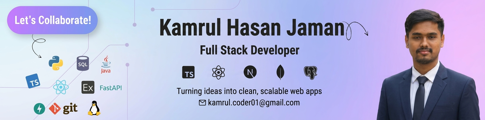

  

<h2 align="center">Hi 👋, I'm Kamrul Hasan Jaman</h2>

 

- 👋 Hi, I'm **[@Ykamrul25](https://github.com/kamrul25)**
- 💻 Passionate about **Full-Stack Web Development**, interested in **Cloud Engineering**, and an enthusiast in **TypeScript** and **Python**.
- 🖥️ I'm currently working with **React.js, TypeScript, and Redux** for frontend development.
- 🛠️ Currently learning **Node.js, Express.js, FastAPI, Prisma, PostgreSQL, and MongoDB** for building backend systems.
- 💬 Ask me about **Full-Stack (React, Node, Express, MongoDB, PostgreSQL)**.
- 📫 Feel free to reach me out via **[Email](mailto:kamrul.coder01@gmail.com)** 

 

### 📩 FOLLOW ME ON SOCIALS:

  
  &nbsp;
  

 

### 💻 TECH STACK & TOOLS:

**Languages:**

  

**Frameworks & Libraries:**

  

**Database & Model:**

  

**Deployment Platform:**

  

**Tools & Technologies:**

  

 

### 📊 GITHUB STATISTICS & ANALYSIS:

**GitHub Contributions:**

  

  
  

